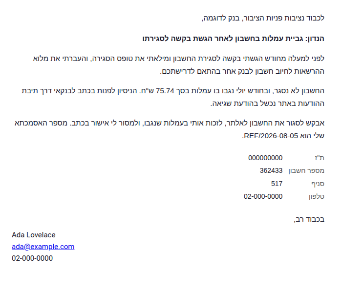

# Claude RTL Email

A Claude Code plugin for sending email in right-to-left scripts — Hebrew,
Arabic, Farsi, Urdu — that actually renders right-to-left in the recipient's
client.



## The problem

**Plain-text email carries no direction metadata.** There is no header, no
marker, nothing in the format that says "this is right-to-left". The client
guesses from the characters.

- **Gmail** guesses per-paragraph and is usually right for solid RTL prose.
- **Outlook** frequently renders LTR.
- **Mixed content is where it fails.** One URL, account number or Latin product
  name is enough to flip the heuristic.

The failure is quiet. Lines start at the left and sentence-final punctuation
lands at the wrong end. It stays readable — which is why it survives review.
What the recipient notices is that the message looks machine-generated.

Worse, multi-part numbers reorder their separators. An account number or IBAN
mangled this way is not a cosmetic problem: it is the string the recipient uses
to find the file.

## What this gives you

| Path | What |
|---|---|
| `skills/configure-rtl-signatures/` | One-time setup. Collects the user's signature, name in both scripts, contact details and organisation identifiers, and persists them. |
| `skills/send-rtl-personal-email/` | Personal mail. Inherits the `personal` profile and an informal register. |
| `skills/send-rtl-business-email/` | Business and institutional mail. Inherits the `business` profile, its identifiers, and a formal register. |
| `assets/templates/base.html` | Minimal RTL body. |
| `assets/templates/formal.html` | RTL body for institutional correspondence — addressee, subject line, identifier block, formal closing. |
| `assets/templates/plain-fallback.txt` | Best-effort plain-text alternative, and why not to rely on it. |
| `references/bidi-rules.md` | **Read before writing an RTL email.** What breaks and why. |
| `references/register.md` | Formal vs ordinary register, per language. |
| `references/composing.md` | The send sequence shared by both send skills. |
| `scripts/preview.sh` | Render an HTML file to PNG and look at it before sending. |
| `scripts/build-examples.py` | Regenerates `examples/` from the templates. |

## Signatures are yours, and stored once

Run `configure-rtl-signatures` on first use. It asks for your name in both
scripts, your contact details, and — for business — your company or national
identifiers, then writes them to:

```
${CLAUDE_USER_DATA:-${XDG_DATA_HOME:-$HOME/.local/share}/claude-plugins}/rtl-email/config.json
```

Nothing is written to `~/.claude/`. The two send skills read that file and stop
asking. If it is missing they will route you back to setup rather than invent a
signature — an email closing with an unfilled `{{SIGNATURE_HTML}}` is worse than
one that renders LTR.

The personal and business profiles carry different signatures, different
registers and different identifier blocks, which is the entire reason they are
separate skills.

**Your RTL name is asked for, never transliterated for you.** People have a
spelling of their own name and being handed a plausible alternative reads badly.

## Transports

Both send skills work with either:

- **Google Workspace MCP** (Gmail) — pass `body_format: "html"`. Omitting it is
  the entire bug this plugin exists to prevent.
- **Resend MCP** — pass the substituted template as `html`. Resend does not
  auto-append a signature, so fill `{{SIGNATURE_HTML}}`.

Neither is bundled. The plugin assumes you already have one configured.

## Use it

```bash
./scripts/build-examples.py
./scripts/preview.sh examples/formal-he.html
```

Then copy a template, substitute the placeholders, preview, send.

## The three rules

Everything else in `references/bidi-rules.md` is elaboration on these:

1. **Set `dir` twice** — as an HTML attribute *and* as CSS `direction`. Outlook
   renders through the Word engine and honours the attribute; webmail honours
   the CSS. Setting both costs nothing.
2. **Repeat `dir="rtl"` on every block element**, not just the wrapper. Mail
   clients rewrite HTML before display and inherited direction does not reliably
   survive. It looks redundant in a browser, where it is redundant — the browser
   is not the target.
3. **Wrap multi-part numbers in `<span dir="ltr">`** — account numbers, phone
   numbers, IBANs, date ranges. A bare figure in RTL prose is fine; anything
   with internal separators will reorder them.

## What is verified, and what is not

Rendering was checked in Chromium on 5 August 2026 via `scripts/preview.sh`, for
both the Hebrew and Arabic examples: direction, alignment, identifier ordering
and signature placement.

**Outlook behaviour is from established email-development practice and is not
verified here** — this repo has no Outlook to test against. The `dir` attributes
are insurance against it rather than a tested accommodation of it. If you can
test in Outlook, a report either way is welcome.

The Arabic and Farsi register guidance in `references/register.md` is
deliberately thin. The bidi mechanics are script-independent and well covered;
the honorific systems are not something this plugin should pretend to encode.

## Origin

Extracted from a real failure: a formal Hebrew complaint to a bank went out with
a plain-text body. The typeset PDF attached to it was correct, so the error was
invisible to everything that got reviewed before sending. The covering note was
the only part rendered by the recipient's mail client, and the only part with no
direction metadata.

The guidance existed at the time. Nothing routed the send through it. That is
why the skill description here names RTL explicitly and why the rule appears at
the top of the skill rather than three-quarters of the way down.

## Licence

MIT. The example content is invented; the identifiers in it are not real.
